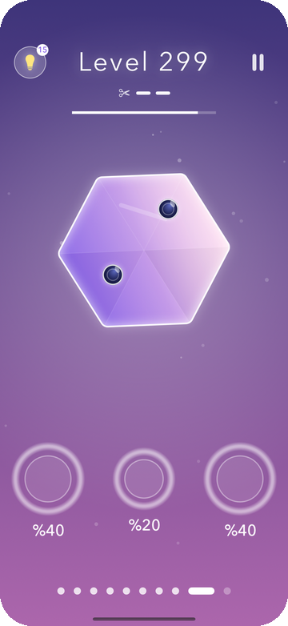

  

<h1 align="center">Slice &amp; Slide</h1>

<i>Kes. Kaydır. Hedefi tuttur.</i>

Slice & Slide, cam gibi parlayan kristalleri parmağınla keserek doğru oranlara böldüğün sakin ama düşündüren bir bulmaca oyunu. Her bölümde bir şekil ve altında hedef halkalar var: şekli, parçaları halkalardaki yüzdelere (%40, %20, %40…) en yakın olacak şekilde kes. Parçalar halkalara süzülür, ne kadar isabetliysen o kadar çok yıldız kazanırsın.

  
  
  
  

## Özellikler

- **5 sezon × 60 bölüm:** Kristal Vadisi, Buz Mağarası, Amber Çölü, Zümrüt Ormanı ve Nova. Her sezonun kendi rengi, müziği, kesim efekti ve yeni bir mekaniği var: kayan çekirdekler, dönen şekiller, süre baskısı…
- **Günlük meydan okuma:** her gün yeni bir bulmaca ve kesintisiz seri takibi.
- **Akış Modu:** 60 saniyede olabildiğince çok bölüm; seri arttıkça müzik hızlanır.
- **İpucu:** takıldığında doğru kesim çizgisini gösterir.
- **Günlük Kristal Sandık:** Normal, Nadir ve Destansı sandıklardan ipucu, seri kalkanı, kristal parçaları ve kozmetikler çıkar.
- **Kişiselleştirme:** kristal görünümleri, kesim izleri, arka plan temaları ve her şeyi birlikte değiştiren tema setleri.
- **16 başarım** ve Game Center sıralamaları.
- **Hissettiren ayrıntılar:** kesimde ağır çekim ve kamera vuruşu, akortlu notalar, kusursuz kesim efekti, sezona özel kutlamalar ve Taptic Engine titreşimleri.
- **Dosyasız ses:** tüm müzikler ve ses efektleri oyun içinde kodla üretiliyor.

## Nasıl oynanır?

1. Parmağını şeklin üzerinde sürükleyerek bir kesim çizgisi çiz.
2. Koyu çekirdeklere değen kesimler reddedilir; çizgini onların etrafından geçir.
3. Kesim hakların bitince parçalar en uygun halkaya yerleşir.
4. Sapma ne kadar küçükse o kadar çok yıldız: kusursuz kesim 3 yıldız getirir.

## Çalıştırma

1. Depoyu klonla ve `SliceSlide.xcodeproj` dosyasını Xcode ile aç.
2. *Signing & Capabilities* bölümünden kendi Apple geliştirici takımını seç.
3. Bir simülatör ya da bağlı iPhone seçip **Run** (⌘R) ile çalıştır.

iOS 17 veya üzeri gerekir.
