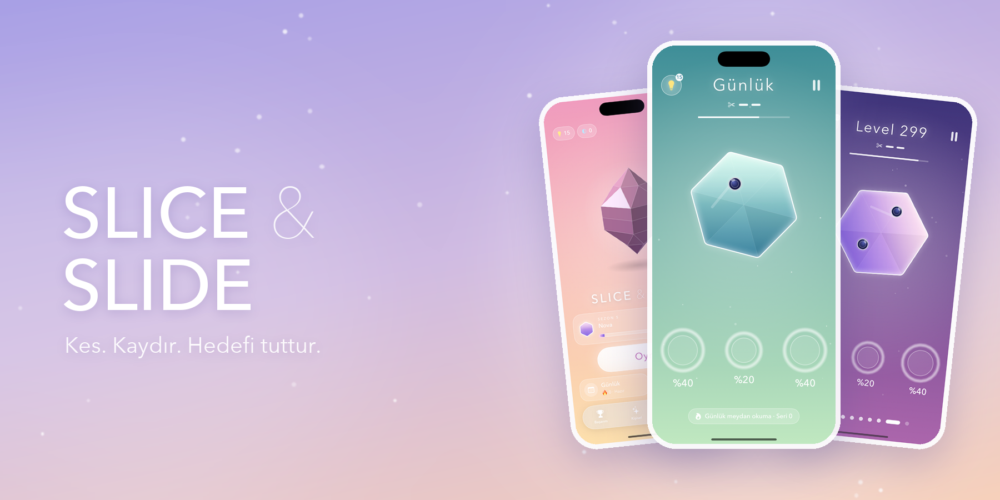
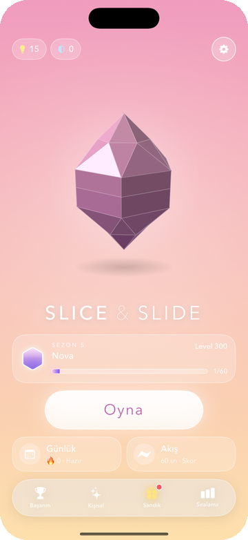
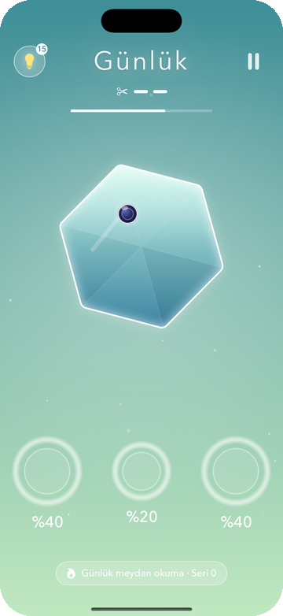
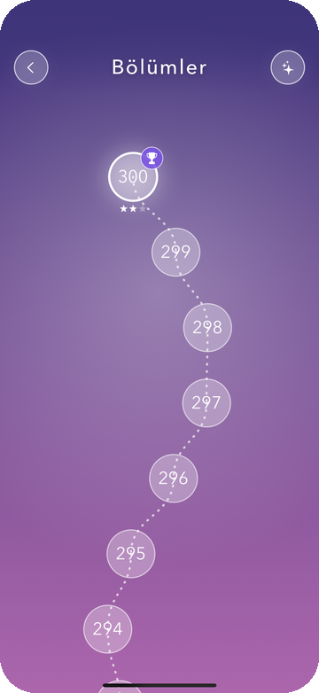

  

<h1 align="center">Slice &amp; Slide</h1>

<i>Slice. Slide. Hit the target.</i>

**English** · [Türkçe](#türkçe)

Slice & Slide is a calm but thoughtful puzzle game where you cut glowing glass crystals with your finger. Every level shows a shape and target rings below it: slice the shape so the pieces match the percentages (40%, 20%, 40%…) as closely as you can. The pieces glide into the rings, and the closer you are, the more stars you earn.

  
  
  
  

## Features

- **5 seasons × 60 levels:** Crystal Valley, Ice Cave, Amber Desert, Emerald Forest and Nova. Each season has its own colors, music, cut effects and a new mechanic: drifting cores, spinning shapes, time pressure…
- **Daily challenge** with a streak counter, and a 60-second **Flow mode** where the music speeds up as your combo grows.
- **Hints** that reveal the correct cut line when you're stuck.
- **Daily crystal chest** with Normal, Rare and Epic tiers: hints, streak shields, crystal shards and cosmetics.
- **Customization:** crystal looks, cut trails, backgrounds and theme sets that change everything at once.
- **18 achievements** and Game Center leaderboards.
- **Game feel:** slow-motion cuts with a camera punch, tuned notes, a flawless-cut effect, season celebrations and haptics.
- **No audio files:** all music and sound effects are generated in code.
- **Localized** in English and Turkish.

## How to play

1. Drag your finger across the shape to draw a cut line.
2. Cuts that touch a dark core are rejected; draw your line around it.
3. When you run out of cuts, the pieces settle into the rings that fit them best.
4. The smaller the deviation, the more stars you get: a flawless cut earns 3 stars.

## Run it

1. Clone the repo and open `SliceSlide.xcodeproj` in Xcode.
2. Pick your own development team under *Signing & Capabilities*.
3. Choose a simulator or a connected iPhone and press **Run** (⌘R).

Requires iOS 17 or later. iPhone only.

---

## Türkçe

*Kes. Kaydır. Hedefi tuttur.*

Slice & Slide, cam gibi parlayan kristalleri parmağınla keserek doğru oranlara böldüğün sakin ama düşündüren bir bulmaca oyunu. Her bölümde bir şekil ve altında hedef halkalar var: şekli, parçaları halkalardaki yüzdelere (%40, %20, %40…) en yakın olacak şekilde kes. Parçalar halkalara süzülür, ne kadar isabetliysen o kadar çok yıldız kazanırsın.

  
  
  
  

## Özellikler

- **5 sezon × 60 bölüm:** Kristal Vadisi, Buz Mağarası, Amber Çölü, Zümrüt Ormanı ve Nova. Her sezonun kendi rengi, müziği, kesim efekti ve yeni bir mekaniği var: kayan çekirdekler, dönen şekiller, süre baskısı…
- **Günlük meydan okuma:** her gün yeni bir bulmaca ve kesintisiz seri takibi.
- **Akış Modu:** 60 saniyede olabildiğince çok bölüm; seri arttıkça müzik hızlanır.
- **İpucu:** takıldığında doğru kesim çizgisini gösterir.
- **Günlük Kristal Sandık:** Normal, Nadir ve Destansı sandıklardan ipucu, seri kalkanı, kristal parçaları ve kozmetikler çıkar.
- **Kişiselleştirme:** kristal görünümleri, kesim izleri, arka plan temaları ve her şeyi birlikte değiştiren tema setleri.
- **18 başarım** ve Game Center sıralamaları.
- **Hissettiren ayrıntılar:** kesimde ağır çekim ve kamera vuruşu, akortlu notalar, kusursuz kesim efekti, sezona özel kutlamalar ve Taptic Engine titreşimleri.
- **Dosyasız ses:** tüm müzikler ve ses efektleri oyun içinde kodla üretiliyor.
- **İngilizce ve Türkçe** dil desteği.

## Nasıl oynanır?

1. Parmağını şeklin üzerinde sürükleyerek bir kesim çizgisi çiz.
2. Koyu çekirdeklere değen kesimler reddedilir; çizgini onların etrafından geçir.
3. Kesim hakların bitince parçalar en uygun halkaya yerleşir.
4. Sapma ne kadar küçükse o kadar çok yıldız: kusursuz kesim 3 yıldız getirir.

## Çalıştırma

1. Depoyu klonla ve `SliceSlide.xcodeproj` dosyasını Xcode ile aç.
2. *Signing & Capabilities* bölümünden kendi Apple geliştirici takımını seç.
3. Bir simülatör ya da bağlı iPhone seçip **Run** (⌘R) ile çalıştır.

iOS 17 veya üzeri gerekir. Yalnızca iPhone.
